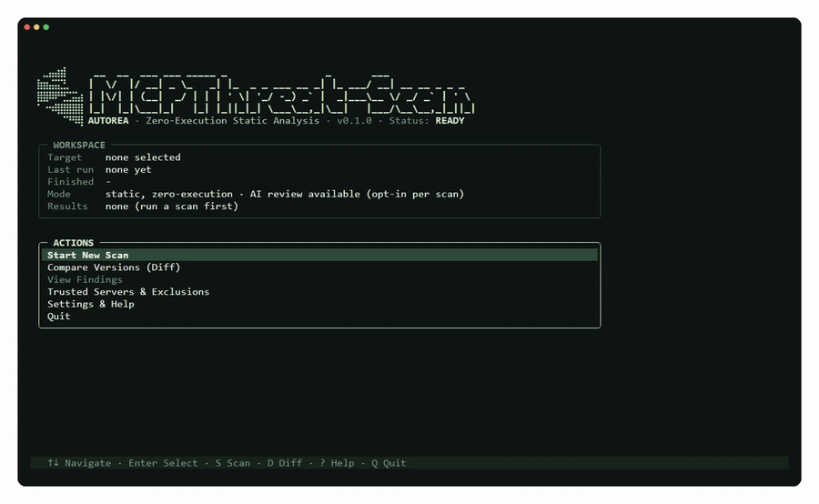

# MCPThreat-Scan

[](LICENSE)
[](pyproject.toml)

**Check MCP servers for security flaws before you trust them — without ever running them.**

MCPThreat-Scan reads the source code of an MCP server (Python, TypeScript or JavaScript)
and reports risks such as hardcoded secrets, command injection and poisoned tool
descriptions. It is made for anyone who connects AI agents to third-party MCP servers
(individuals, developers and teams) and wants to know what a server can do before giving it
access to their data and tools. Because the scanned code is never executed, it is safe to
scan servers you do not trust yet. If you build MCP servers yourself, use it to check your
own code before a release.

[](assets/demo/demo.mp4)

*Scanning a folder in the interactive interface. Click the animation to watch the 30-second video.*

## Example

```text
$ mcpthreat-scan scan benchmark/vulnerable/command_injection.py

benchmark\vulnerable\command_injection.py:
  Line 9 [Command Injection] ERROR: Command Injection: A function parameter flows unchecked
  into a shell command or eval/exec. ...

Summary: 8 of 9 OWASP MCP categories without findings.
Categories with findings: Command Injection
```

Every finding shows the file, line, category, severity and a hint on how to fix it.

## Features

- **Zero-execution:** the code is only read and parsed, never run, so it is safe to scan
  servers you do not trust yet
- **9 OWASP MCP risk categories:** from hardcoded secrets and command injection to tool
  poisoning and typosquatting
- **Rug-pull detection:** compare two versions of a server and see changed tools, parameters
  and descriptions (`diff`)
- **Optional AI review** of tool-poisoning candidates (opt-in with `--ai-review`)
- **CI-ready:** text, JSON and SARIF output, and `--fail-on` to fail a build by severity
- **Interactive terminal UI** (`tui`)
- **Open benchmark** with known test cases, so you can check how the rules perform

## Quick start

Requires Python 3.12+ and Git.

```bash
git clone https://github.com/0xtahaa/MCPThreat-Scan.git
cd MCPThreat-Scan
python -m venv .venv
source .venv/bin/activate        # Windows: .venv\Scripts\activate
pip install -e .
```

The commands below assume the virtual environment is active.

**Interactive interface (recommended to start):**

```bash
mcpthreat-scan tui
```

It guides you through choosing a target, running the scan and reading the findings.

**Command line:** scan a single file or a whole folder:

```bash
mcpthreat-scan scan path/to/mcp_server.py
```

Optional: for the AI review (`--ai-review`), store an `OPENAI_API_KEY` in a local `.env`
file. It is never committed (see `.gitignore`).

### Set up with an AI assistant

Copy this prompt into Claude Code, Codex or a similar agent. It only installs the tool.

```text
Set up MCPThreat-Scan for me. Only do the setup, do not scan anything.

1. Check that Python 3.12+ and Git are installed. If not, tell me how to install them.
2. Clone https://github.com/0xtahaa/MCPThreat-Scan.git, create a virtual environment
   and run `pip install -e .`.
3. Check the installation with: mcpthreat-scan --help
4. Tell me how to start the interactive interface myself:
   mcpthreat-scan tui

Show me each command before you run it.
```

> **Run the scans yourself.** We recommend not letting an AI agent scan or read untrusted
> servers for you: scanned code can contain instructions aimed at AI agents, which is exactly
> what the *Tool Poisoning* check looks for. Use the interactive interface or the command line.

## Usage

### Scan

Scan a single file or a whole folder:

```bash
mcpthreat-scan scan path/to/mcp_server.py
mcpthreat-scan scan path/to/project/
```

The default output is readable text. Tool-poisoning findings are first reported as
*candidates*. With `--ai-review`, an OpenAI model reviews each candidate and confirms or
dismisses it:

```bash
mcpthreat-scan scan path/to/mcp_server.py --ai-review
```

This needs an `OPENAI_API_KEY`. Without one, the scan does not abort and the candidate simply
stays unconfirmed.

### Compare two versions (rug-pull detection)

A server that was harmless in version 1 can turn malicious in version 2. Compare two versions
of the same file to see what changed in tool names, parameters, descriptions and hidden
behavior:

```bash
mcpthreat-scan diff server_v1.py server_v2.py
```

### Output formats and CI

| Option | Effect |
|---|---|
| `--format text` | Readable text (default) |
| `--format json` | Machine-readable JSON |
| `--format sarif` | SARIF 2.1.0, the standard for GitHub Code Scanning and other CI tools |
| `--fail-on ERROR\|WARNING\|INFO` | Exit code 1 as soon as a finding is at least that severe. Without this flag the exit code is always 0. |

> **Note:** JSON and SARIF include the flagged source line or description (`evidence`),
> which comes straight from the scanned code. Do not pass these reports to an AI agent.

Example for GitHub Actions: fail the build on errors and upload the results to GitHub
Code Scanning.

```yaml
name: MCP security scan
on: [push, pull_request]

jobs:
  scan:
    runs-on: ubuntu-latest
    permissions:
      contents: read
      security-events: write
    steps:
      - uses: actions/checkout@v4
      - uses: actions/setup-python@v5
        with:
          python-version: "3.12"
      - run: pip install git+https://github.com/0xtahaa/MCPThreat-Scan.git
      - run: mcpthreat-scan scan . --format sarif --fail-on ERROR > results.sarif
      - if: always()
        uses: github/codeql-action/upload-sarif@v3
        with:
          sarif_file: results.sarif
```

### Interactive interface (TUI)

```bash
mcpthreat-scan tui
```


From the main menu you can:

- **Start New Scan:** pick a file or folder, confirm, follow the scan and read the summary
- **View Findings:** filter by severity and open a detail view with description and
  recommendation for each finding
- **Compare Versions:** compare two files or two folders and see changed tool definitions
  plus new and resolved findings
- **Trusted Servers & Exclusions:** manage trusted servers and ignore rules
- **Export:** save the report as JSON or SARIF with `E`


Shortcuts are shown on every screen. On the main menu: `S` scan, `D` compare, `?` help,
`Q` quit. A running scan cannot be cancelled safely, because Semgrep runs as one external
process.

## Configuration

### Ignoring findings

If you have reviewed a finding and accept it, ignore it. In the TUI, open the finding and press
`i`. The rule is saved in a file called `.mcpscannerignore` in the folder you run the scan from.

On the command line or in CI you can edit that file yourself, one rule per line as
`file:Category`:

```text
# reviewed and accepted
src/server.py:Missing Audit Logging
```

Ignored findings are counted in the summary, so nothing disappears silently.

### Network access and your data

The scan reads your code locally. Two features talk to external services:

| Feature | What is sent |
|---|---|
| Supply-chain check | Dependency names and versions are looked up in the OSV vulnerability database through `pip-audit` |
| `--ai-review` | The text of each tool-poisoning candidate (the flagged tool description or handler output, not whole files) goes to the OpenAI API, default model `gpt-4o-mini` |

For the AI review, the candidate text is wrapped in markers and the model is instructed to treat
it as data only. Your `OPENAI_API_KEY` is read from the environment or a local `.env` file.
Checking `package-lock.json` for npm projects needs the separate
[osv-scanner](https://google.github.io/osv-scanner/) program on your `PATH`.

## What it checks

MCPThreat-Scan checks for the most common known vulnerabilities in MCP servers, based on OWASP.

| Category | What is checked |
|---|---|
| Hardcoded Secret | API keys or tokens written directly in the source code |
| Command Injection | Tool input that reaches `eval`, `exec`, `os.system` or `subprocess` without checks |
| Header Leak | Request headers ending up in error messages |
| Unscoped Environment Access | Environment variables read on every tool call instead of once at startup |
| Tool Poisoning | Hidden instructions for AI agents in tool descriptions or tool output. Rug pulls are found with `diff`. |
| Supply Chain | Dependencies with known vulnerabilities (`requirements.txt`, and `package-lock.json` with osv-scanner) |
| Missing Audit Logging | Security-relevant actions without any logging |
| Capability Mismatch | A tool that makes network or email calls without saying so in its name or description. This is a keyword heuristic and does not detect deliberately deceptive descriptions. |
| Typosquatting / Shadow Server | A server name that closely resembles a known server. A candidate, not proof. |

Command Injection, Hardcoded Secret, Header Leak, Tool Poisoning and Unscoped Environment Access
cover Python and TypeScript/JavaScript. Capability Mismatch and Missing Audit Logging currently
cover Python only.

Not covered: precise scope measurement (needs runtime tracing), a general prompt-injection content
filter, server operations monitoring and shadow-server discovery.

## Benchmark

The rules are tested against example servers with known vulnerabilities and known-clean
examples in [`benchmark/`](benchmark/). Run it yourself from the repository root:

```bash
python -m benchmark.evaluate
```

Result without `--ai-review` (rules and supply-chain check only):

| Category | TP | FP | FN | Precision | Recall |
|---|---|---|---|---|---|
| Capability Mismatch | 2 | 0 | 0 | 100 % | 100 % |
| Command Injection | 2 | 0 | 0 | 100 % | 100 % |
| Hardcoded Secret | 2 | 0 | 0 | 100 % | 100 % |
| Header Leak | 2 | 0 | 0 | 100 % | 100 % |
| Missing Audit Logging | 6 | 0 | 0 | 100 % | 100 % |
| Supply Chain | 2 | 0 | 0 | 100 % | 100 % |
| Tool Poisoning | 6 | 1 | 2 | 86 % | 75 % |
| Typosquatting / Shadow Server | 2 | 0 | 0 | 100 % | 100 % |
| Unscoped Environment Access | 5 | 0 | 0 | 100 % | 100 % |
| **Total** | **29** | **1** | **2** | **97 %** | **94 %** |

**How to read this:** The examples were written together with the rules, so the benchmark
shows that the rules do what they are meant to do. It is not an independent measurement of
accuracy on real-world servers. A sample of 40 findings from public MCP servers is prepared for
manual rating ([`benchmark/precision_sample.csv`](benchmark/precision_sample.csv)). The
real-world precision will be published once it is rated.

Tool Poisoning is weaker on purpose: the rules only deliver candidates, and `--ai-review` is
what confirms them. The AI review is not measured here. The two misses are rug-pull cases from
`benchmark/rugpull/`, see [Limitations](#limitations).

## Limitations

- **Findings are candidates, not proof.** Some checks (Tool Poisoning, Capability Mismatch,
  Typosquatting) are heuristics. They can raise false alarms, and a carefully disguised attack
  can slip through. `--ai-review` helps to confirm Tool Poisoning candidates, but it is not
  measured in the benchmark.
- **Only static analysis.** The scanner never runs the code, so it cannot see what a server does
  at runtime.
- **Languages:** Python and TypeScript/JavaScript. Capability Mismatch and Missing Audit Logging
  cover Python only.
- **Rug-pull detection compares two versions that you provide.** It does not watch a server over
  time. In the benchmark it misses two cases (`benchmark/rugpull/`), and these cases are not part
  of the automatic benchmark run.
- **No real-world accuracy figures yet.** See [Benchmark](#benchmark).

## Contributing

Issues and pull requests are welcome. Before opening a pull request, run the tests and the
benchmark:

```bash
pip install -e ".[dev]"
pytest
python -m benchmark.evaluate
```

## Development

### Project structure

```
src/mcpthreat_scan/
  cli/         Command-line interface (argparse: scan, diff, tui) — parsing only, delegates to core
  tui/         Interactive terminal interface (Textual)
  core/        Orchestration (run_scan, run_diff), categories/severities, shared exceptions
  analyzers/   Semgrep (layer 1), AI review (layer 2, OpenAI), supply chain (pip-audit/OSV),
               typosquat, capability post-filter — one task per analyzer, no analyzer chains
  diff/        AST extraction of tool functions (never executed) and rug-pull comparison
  policy/      .mcpscannerignore and reputation/whitelist
  reporting/   Renderers for text, JSON and SARIF
  resources/   Semgrep rules (rules/, one file per OWASP MCP category), known_mcp_servers.json
benchmark/   Test cases with known results (vulnerable/, clean/, rugpull/) + expected_results.json
             + evaluate.py (precision/recall; uses the core API, not part of the installable package)
tests/       Unit tests (pytest)
```

### Known issues

- **`policy/reputation.py` is not used by the scan.** The whitelist/fingerprint mechanism (meant to
  skip costly re-review for established, unchanged servers) is not wired into the scan pipeline;
  only the TUI management (`list_reviewed`, `revoke_review`) and the tests call it.
- Two tests (`test_ai_review.py`, real OpenAI call) are skipped without `OPENAI_API_KEY`. Tests
  with an OSV query via `pip-audit` (`test_dependency_check.py`) need network access and may fail
  without it, which is an external dependency and not a code error.

## License

Apache License 2.0, see [LICENSE](LICENSE).
